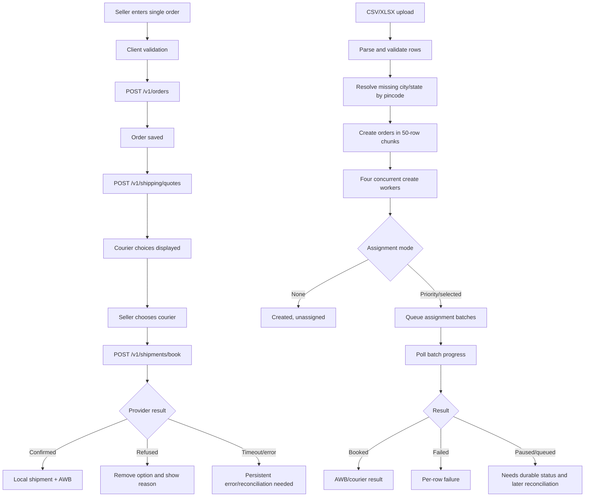

# Frontend Order-to-Booking Flow — First-Pass Audit

**Date:** 2026-11-25  
**Repository:** `riju-talk/Nexgo`  
**Branch:** `qa/production-readiness-2day`  
**Audit type:** Static code inspection only. No local application execution, browser test, provider transaction, or production log review has been performed in this pass.

## 1. Frontend route structure

Several route files are thin wrappers around `AppPage`. The QA target is the live component mapped by page ID in `components/AppPage.jsx`, not the route wrapper alone.

| Seller flow | Route/page ID | Component |
|---|---|---|
| Orders | `/orders` / `orders` | LiveSellerOperations / Live orders |
| Create single order | `/orders/b2c` / `b2c` | `LiveCreateOrder.jsx` |
| Bulk upload | `/orders/bulk` / `bulk-orders` | `LiveBulkOrderImport.jsx` |
| Dropship | `/orders/dropshipping` / `dropship` | `LiveCreateOrder.jsx` (flow mode) |
| Ship now | `/orders/ship-now` / `shipnow` | `LiveCreateOrder.jsx` (flow mode) |
| Reverse order | `/orders/reverse` / `reverse` | `LiveCreateOrder.jsx` (flow mode) |
| Shipments / Track | `/shipments` / `shipments` | `LiveTrack.jsx` |
| Shipment detail | `/shipments/detail` / `ship-detail` | `LiveShipmentDetail.jsx` |

## 2. Flow map

## 3. Confirmed static finding: paused batch may be misreported as assignment success

### Evidence path

- `lib/assignBatches.js`: polling helper detects fully paused queue, increments paused count and breaks polling. In that branch, it does not append per-order results (paused orders remain queued).
- `components/LiveBulkOrderImport.jsx`: importer maps returned assignment results by orderId. Missing result entries do not get `unassigned: true`. The final created-success count is calculated as `created && !unassigned`.
- Therefore an order created successfully but still paused/queued can be counted as successfully created-and-assigned even though no AWB/courier result was returned. This is a static logic conclusion; a runtime test must confirm the visible exact text and states.

### User impact

- The final summary may overstate assigned orders.
- Seller may assume booking is complete, then discover shipments remain unbooked.
- Retry behavior is risky if the seller cannot distinguish queued from failed or confirmed booked.

### Correct state model

Bulk outcome should use distinct states and counts:

- `invalid`
- `create_failed`
- `created_unassigned`
- `queued`
- `processing`
- `paused`
- `booked`
- `assignment_failed`
- `reconciliation_required`

Only `booked` with durable shipment/AWB should count as booked. The batch ID should be preserved and outcomes reloaded from server after pause or page refresh.

### Required tests

1. Provider booking pause occurs after orders are created; UI reports queued/paused, not booked.
2. Worker is stopped after queue acceptance; status remains queued/stalled and actionable.
3. Worker restart resumes safely; rows move to booked/failed and summary is corrected.
4. Pause-resume causes no duplicate shipment, debit, or order creation.
5. Importer export contains every original row and accurate status, including queued items.
6. Re-upload after a pause does not duplicate existing orders or active assignment jobs.

## 4. Confirmed static finding: print popup handoff failure is not reliably surfaced

In `components/LiveTrack.jsx`, `openDocs()` returns `window.open()`. The caller only surfaces an error if the return value is exactly `false`. A blocked popup (or null result from a `noopener` window-open mode) can return `null`, which is not `false`. The seller may receive no document tab and no clear error.

Additional cases:
- Small selection opens URL with IDs directly.
- Larger selection stores IDs in localStorage and opens a batch page.
- localStorage failure is handled by returning false, but the caller's error text only describes the selection being too large, not storage failure.

Required UX:
- Provide a reliable in-app print/download path with popup-blocked detection.
- Avoid confusing storage-handoff failure with “too many IDs”.
- Show selected count, requested count, document-ready count, and failed count.

## 5. Order create and quote behavior

`LiveCreateOrder.jsx` sends `POST /v1/orders` before calling `POST /v1/shipping/quotes`. Thus order creation can succeed even when quote retrieval fails. The UI must preserve the saved order and clearly show quote failure without encouraging a duplicate create. Verify the current recovery/reset behavior and ensure a retry of the quote does not recreate the order.

## 6. Bulk upload architecture notes

Static inspection shows:
- Maximum import order count is 5,000.
- Product/item count is capped at 5 per order.
- The import groups valid orders into chunks of 50.
- Four concurrent workers create the chunks.
- Missing city/state are resolved using concurrent pincode lookup chunks of 20.
- Courier assignment follows order creation and uses the shared batch assignment helper.

This design can improve throughput but is sensitive to partial API failure, concurrent requests, ambiguous timeout, chunk-index mapping, duplicate row numbers/order numbers, pause state, worker availability, and import file identity. The next QA pass should test every boundary and verify mapping by row identity, not only order number.

## 7. Priority for immediate work

1. Reproduce and fix paused/queued bulk-assignment false success (P1).
2. Confirm readiness validation in the queue/worker before provider calls (P1).
3. Booking idempotency/concurrency/timeout reconciliation (P0).
4. Worker health and stale queue visibility (P0).
5. Provider integration health and Shiprocket orphan-order recovery (P0/P1).
6. Persistent single-order quote/booking recovery UI.
7. Print popup and document-storage fallback.
8. Bulk row-level result contract and retry/export correctness.
9. Pagination and selection limits; ensure accessible page counts.
10. Full browser regression of order-to-AWB journey.

## 8. Evidence and limitations

Inspected static source:
- `components/AppPage.jsx`
- `components/LiveCreateOrder.jsx`
- `components/LiveBulkOrderImport.jsx`
- `components/LiveTrack.jsx`
- `lib/assignBatches.js`
- `backend/src/routes/assignBatches.ts`
- Prior review notes for booking, worker, Shiprocket, pagination, document jobs and export behavior.

Not yet inspected/executed in this pass:
- Full UI component rendering and interaction.
- Browser console/network.
- Production logs and current DB state.
- Worker health in staging/production.
- Live Shiprocket/Lorrigo transactions.
- Full test suite, lint, build, typecheck, migration tests.
- Exact UX copy and visual states.
